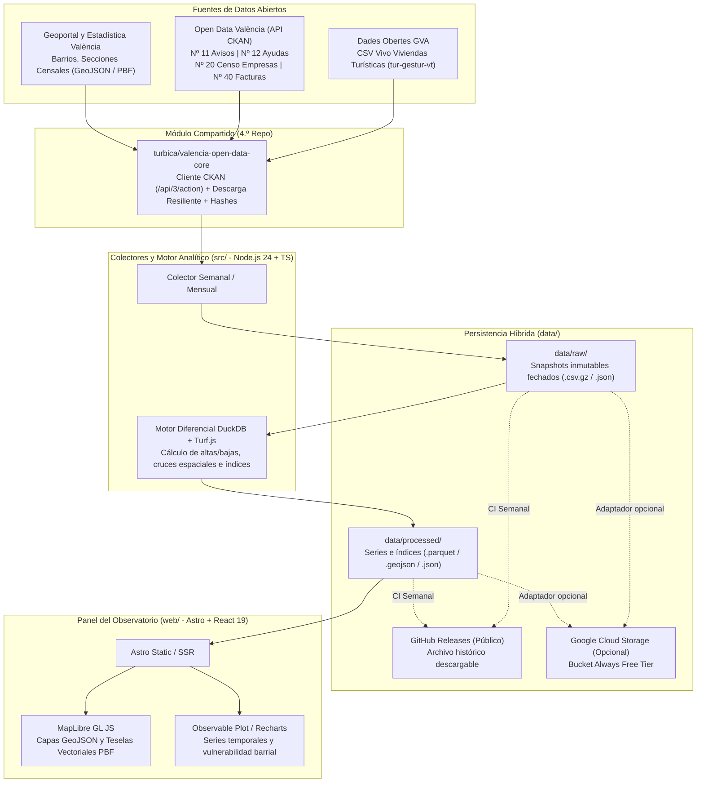

# Arquitectura Técnica — `radar-vivienda`

## 1. Principios de diseño

1. **Observatorio vivo sin mantenimiento manual**: la ingesta de fuentes abiertas (GVA y Ayuntamiento de València) está automatizada y desacoplada del despliegue web.
2. **El histórico es el activo principal**: dado que la Generalitat Valenciana (`tur-gestur-vt`) publica únicamente la fotografía instantánea de licencias de viviendas turísticas vigentes sin serie histórica, cada captura semanal en `data/raw/` es inmutable y fechada (`YYYY-MM-DD`).
3. **100 % Open Source y coste 0 €**:
   - Sin servidores de bases de datos permanentes ni licencias propietarias de mapas.
   - El repositorio público automatiza la ingesta mediante **GitHub Actions** y publica las instantáneas en **GitHub Releases** para que cualquier persona, asociación vecinal o grupo de investigación pueda hidratar su entorno local (`pnpm data:sync`) con toda la serie histórica desde el primer día.
   - Empaquetado listo para ejecutar con **Docker Compose** en cualquier máquina o desplegar en las capas gratuitas (*Always Free*) de **Google Cloud Run**, **Google Cloud Storage** y **Firebase Hosting**.

---

## 2. Diagrama de arquitectura

---

## 3. Capas del Stack Tecnológico

| Capa | Tecnología | Justificación |
|---|---|---|
| **Runtime & Monorepo** | Node.js 24 LTS + `pnpm` workspaces + TypeScript | Unifica el lenguaje entre los colectores (`src/`), el conector común y el panel web (`web/`), compartiendo tipos y validaciones. |
| **Conector CKAN Común** | `turbica/valencia-open-data-core` | Paquete compartido entre `radar-vivienda`, `escudo-hidrologico` y `monitor-vmp`. Consulta `/api/3/action/package_show`, verifica `metadata_modified` y gestiona reintentos y sumas SHA-256. |
| **Motor Analítico y Espacial** | `@duckdb/node-api` + `@turf/turf` + `zod` | Permite ejecutar diffs SQL entre instantáneas CSV de decenas de miles de registros y cruzar polígonos de barrios en milisegundos sin servidor externo. |
| **Persistencia de Datos** | Sistema de archivos local (`./data`) + GitHub Releases + adaptador opcional `@google-cloud/storage` | Permite trabajar 100 % en local o con volúmenes Docker, respaldar el histórico públicamente en GitHub Releases y escalar opcionalmente en GCP Free Tier. |
| **Panel Web y Cartografía** | Astro 5 + React 19 + Tailwind CSS v4 + MapLibre GL JS + Observable Plot | Genera un observatorio estático/híbrido ultrarrápido que consume directamente GeoJSON/Parquet y teselas vectoriales PBF libres sin costes por visualización de mapa. |
| **Contenedores** | `Dockerfile` multi-etapa + `docker-compose.yml` | Dos servicios ligeros (`collector` y `web`) que comparten el volumen `./data` para despliegue reproducible en 1 comando. |

---

## 4. Flujo de datos y convención de nombres en `data/`

1. **`config/fuentes.json`**: única fuente de verdad con los identificadores y endpoints. Ninguna URL se codifica directamente en `src/` ni en `web/`.
2. **`data/raw/` (inmutable)**:
   - `gva-viviendas-turisticas/YYYY-MM-DD_tur-gestur-vt.csv`
   - `valencia-ckan/<dataset-slug>/YYYY-MM-DD_<resource-id>.<ext>`
   - Junto a cada descarga se guarda un archivo `.meta.json` con fecha de captura, URL de origen, hash SHA-256 y licencia del publicador.
3. **`data/processed/` (regenerable a partir de `data/raw/`)**:
   - `series_viviendas_turisticas.parquet` y `series_viviendas_turisticas.json`: evolución de altas, bajas y stock neto por barrio y código postal entre instantáneas.
   - `indice_vulnerabilidad_barrios.geojson`: capa espacial lista para MapLibre GL JS con los indicadores cruzados (presión turística, variación de censo comercial, avisos ciudadanos de deterioro, ayudas sociales y facturación municipal).
   - `resumen_observatorio.json`: métricas agregadas y marcas temporales para la portada del panel web.

---

## 5. Relación con `turbica/valencia-open-data-core`

Para evitar duplicar el cliente CKAN y las utilidades de ingesta entre los tres proyectos hermanos (`radar-vivienda`, `escudo-hidrologico` y `monitor-vmp`), el conector vive en el repositorio **`turbica/valencia-open-data-core`** y exporta:

- `CkanClient`: cliente tipado para `/api/3/action` (`package_show`, `package_search`, `resource_show`, `datastore_search`).
- `downloadSnapshot`: descarga con control de `ETag` / `Last-Modified`, cálculo de hash SHA-256 y escritura atómica con fecha en `data/raw/` sin sobrescribir jamás archivos previos.
- `StorageAdapter`: interfaz común para persistir y sincronizar `data/raw/` y `data/processed/` en disco local o en Google Cloud Storage.
